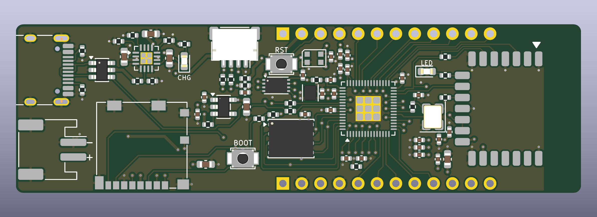

# RP2350 Wi-Fi/BLE dev board (rev A)

A 76.2 x 22.86 mm, 4-layer RP2350A development board with Wi-Fi/BLE, LiPo charging with power path,
microSD, Qwiic and an addressable RGB LED. All 71 components sit on the top side so PCBWay can build it
with a single-sided SMT pass.



**Status: designed, not built.** ERC is clean; DRC is clean (0 errors, 0 unconnected, schematic parity OK,
one harmless "dangling via" warning). Nothing here has been verified on hardware — read
"What a reviewer should check" before ordering.

## Where things are

| Path | What |
|---|---|
| `boards/rp2350-devboard/` | KiCad project: `.kicad_pro`, `.kicad_sch`, `.kicad_pcb`, project symbol lib, custom DRC rule |
| `fab/rp2350-devboard-gerbers.zip` | Gerbers (RS-274X, 4 copper layers) + Excellon drill files — upload this to PCBWay |
| `fab/gerbers/` | The same files unzipped |
| `fab/assembly/rp2350-devboard-bom.csv` | BOM in PCBWay's column layout (36 lines, 71 parts, all SMD) |
| `fab/assembly/rp2350-devboard-centroid.csv` | Pick-and-place file (origin = bottom-left board corner, mm) |
| `fab/assembly/rp2350-devboard-assembly-top.pdf` | Assembly drawing with reference designators and notes |
| `fab/docs/` | Schematic PDF, fab drawing, IPC-D-356 netlist, STEP model, renders |
| `tools/` | Generator scripts. `tools/design.py` is the single source for parts, nets and placement |

The files were made with Backplane KiCad 10.99 (newer file format than stock KiCad 10.0).

## PCBWay order settings

- 4 layers, 76.2 x 22.86 mm, 1.6 mm FR-4, 1 oz outer / 0.5 oz inner is fine
- Min track/space **0.15 / 0.10 mm** (the 0.10 mm spacing occurs only where VREG_LX passes between two 0402 pads; everything else is ≥ 0.15 mm), min hole 0.3 mm, via 0.6 / 0.3 mm
- Finish: ENIG (0.4 mm pitch QFN-60), any solder-mask colour, vias tented
- Assembly: top side only, turnkey. Stencil top only
- **Not populated on purpose:** the two 1x12 2.54 mm header rows (J5, J6) and the three bottom-side SWD test pads (TP1–TP3). They are bare holes/pads and are excluded from BOM and centroid
- **L1 is polarised**: the dot on the Abracon inductor goes to pad 1 (+1V1 net, the pad towards the bottom board edge). This is in the BOM notes and on the assembly drawing

## What is on the board

| Function | Part | Notes |
|---|---|---|
| MCU | RP2350A (QFN-60, A4 stepping) | on-chip 1.1 V SMPS with the Abracon AOTA-B201610S3R3-101-T inductor, 12 MHz ABM8-272-T3 crystal |
| Flash | W25Q128JVPIQ, 16 MB | QSPI CS0 |
| PSRAM | APS6404L-3SQR-ZR, 8 MB | QSPI CS1 on GPIO0, 10 k pull-up |
| USB | USB-C (HRO TYPE-C-31-M-12) | 5.1 k CC resistors, USBLC6-2SC6 ESD, 27 Ω series resistors |
| Charger | BQ24074 | power path, ~300 mA charge, 500 mA USB input limit, orange CHG LED |
| 3.3 V | TLV75733P 1 A LDO | fed from the charger's system output; EN on a header pin |
| Battery monitor | 200 k / 200 k divider + 100 nF | VBAT/2 on GPIO29 (ADC3) |
| Wi-Fi / BLE | Raspberry Pi Radio Module 2 (CYW43439) | wired like Pico 2 W, user LED on the module's GPIO0 |
| microSD | Molex 104031-0811 | 4-bit SDIO or SPI0, card-detect on GPIO1 |
| Qwiic / STEMMA QT | JST SM04B-SRSS-TB | I2C0 on GPIO24/25 with 2.2 k pull-ups |
| RGB LED | WS2812B-2020 (V6) | GPIO23, powered from 3.3 V |
| Buttons | 2 x Omron B3U-1000P | BOOT (QSPI_SS through 1 k) and RST (RUN) |

### Pin map

| GPIO | Use | GPIO | Use |
|---|---|---|---|
| 0 | PSRAM CS (XIP_CS1) | 16 | RM2 WL_ON (also BT_ON) |
| 1 | SD card detect (low = card in) | 17 | RM2 CS |
| 2 | SD CLK (SPI0 SCK) | 18 | RM2 data (DIN direct, DOUT via 470 Ω, IRQ via 10 k) |
| 3 | SD CMD (SPI0 TX) | 19 | RM2 clock |
| 4 | SD D0 (SPI0 RX) | 20–22 | header |
| 5, 6 | SD D1, D2 | 23 | RGB LED data |
| 7 | SD D3 / CS | 24, 25 | SDA, SCL (header + Qwiic) |
| 8–15 | header | 26–28 | header (ADC0–2) |
| | | 29 | battery voltage / 2 (ADC3) |

Headers (0.8" row spacing, breadboard-friendly, pin 1 nearest the USB end):

- Top row: VBUS, VBAT, EN, GND, GP28, GP27, GP26, SCL (GP25), SDA (GP24), GP22, GP21, GP20
- Bottom row: 3V3, GND, VSYS, GND, GP8, GP9, GP10, GP11, GP12, GP13, GP14, GP15

Pin names are printed on the bottom silkscreen. SWCLK, SWDIO and GND are test pads on the bottom.

For the Pico SDK, build for a Pico 2 W-style board with `CYW43_PIN_WL_REG_ON=16`, `CYW43_PIN_WL_CS=17`,
`CYW43_PIN_WL_DATA_OUT/IN/HOST_WAKE=18`, `CYW43_PIN_WL_CLOCK=19`.

## Key decisions

- **RP2350A, not B.** 30 GPIO is enough: 14 are used on the board and 16 go to the headers.
- **Raspberry Pi RM2 for the radio** rather than an ESP32 co-processor. It works with the stock Pico SDK / MicroPython CYW43 driver, carries its own antenna and modular certification, and needs only four GPIOs. The antenna end sits at the board edge with a 5 mm copper-free strip on all layers.
- **BQ24074 + LDO.** A true power path lets the board run from USB with no battery or a flat one. I chose an LDO over a buck-boost to keep the layout simple; the cost is that 3.3 V sags once the cell drops below about 3.5 V (the RM2 wants ≥ 3.0 V, ≥ 3.2 V for full RF performance).
- **Charge current ~300 mA** (R7 = 3.0 k; I = 890 / R7). Suits cells of 300 mAh and up; change R7 for other cells.
- **Regulator layout copies the Raspberry Pi reference**: VREG_LX runs between the pads of the input and output capacitors to the inductor, with one shared capacitor for pins 53/54. That is where the 0.10 mm spacing comes from (a custom DRC rule allows it for that net only).
- **All parts on top.** This made the board long (76 mm). Putting the microSD socket on the back would save about 14 mm at the price of double-sided assembly.
- **How the files were made.** Schematic and board are generated from `tools/design.py`. The RP2350 fan-out, regulator, QSPI, SD bus and other critical routes are explicit coordinates in that file; the remaining ~60 connections were finished by a small grid router (`tools/maze.py`) and checked with KiCad's DRC. The routing is electrically clean but not hand-polished.

## What a reviewer should check

1. **Battery polarity.** J2 pin 2 (marked `+`, the pad nearer the bottom edge) is positive. I could not confirm this matches the common Adafruit/SparkFun JST-PH wiring. Check your cell before plugging in — there is no reverse-polarity protection.
2. **microSD card-detect pins.** I wired socket pad 9 to GPIO1 and pad 10 to GND, assuming the switch sits between those two pads. If Molex's drawing says otherwise, card detect will read wrong; the card itself still works.
3. **RM2 footprint** is KiCad's library footprint `RF_Module:RMC20452T`; I checked its pad positions against the RM2 datasheet drawing, not against a physical module.
4. **Three signals use short tracks on In2** (the 3.3 V plane): QSPI SD1 and SD2 to the PSRAM, PSRAM CS, and RUN to the reset button. They were the only way to cross the SD bus and radio lines with single-sided assembly. They cut narrow slots in the plane; the GND plane on In1 is unbroken.
5. **Decoupling is a compromise.** Most mid-side RP2350 supply pins drop to the planes through vias inside the pad ring, with their 100 nF capacitors 3–6 mm away. Raspberry Pi's own minimal design makes a similar trade, but this is the first thing I would probe on a prototype (1.1 V ripple under Wi-Fi load).
6. **Things left out to keep the layout routable:**
   - no external pull-ups on the SD lines (use the RP2350's internal ones);
   - no external pull-up on RUN (internal only) and RUN is not on a header pin;
   - the RM2's GPIO2 is not wired to VBUS sense as on a Pico W;
   - no fiducials or mounting holes.
7. **Battery sense leakage.** The divider draws about 10 µA from the cell all the time, and GPIO29 is not fail-safe: with 3.3 V switched off through EN a few µA flow into the pin.
8. **Power track widths** are 0.25–0.4 mm for VBUS/VBAT/VSYS. That is adequate for the 500 mA input limit but not generous.
9. **BOM part numbers.** ICs, connectors, LEDs and switches were checked against LCSC stock on 2026-11-09 (the RM2 had only 51 pieces there; PCBWay may source it elsewhere). The Yageo/Samsung passive part numbers were written from the manufacturers' naming scheme and not looked up — any equivalent 0402/0603 part of the same value and rating is fine.
10. The USB pair is routed for full-speed only (no impedance control), which is all the RP2350 supports.

## Regenerating

```
tools/build_all.sh            # schematic, netlist check, pours, DRC, fab outputs (keeps the routing)
tools/build_all.sh --reroute  # also throws the routing away and routes again (about 2 minutes)
```
