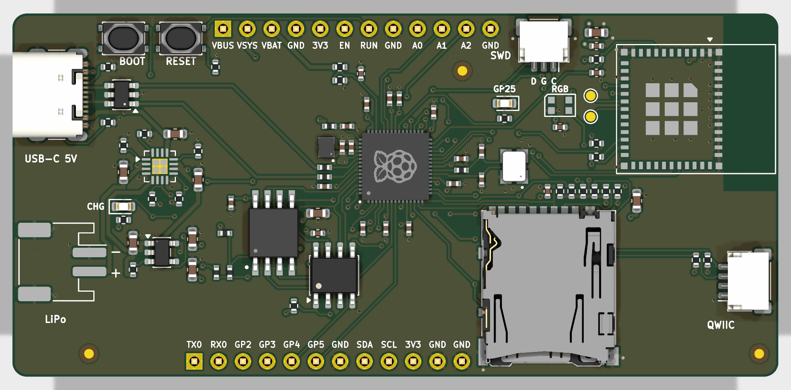

# RP2350 Wireless Dev Board (Rev A)

An 80 × 38 mm, 4-layer RP2350 development board designed for **turnkey manufacture and assembly
by PCBWay** (every part on the BOM is placed by PCBWay; all SMD parts are on the top side, the two
pin headers are the only through-hole parts).

| Feature | Implementation |
|---|---|
| MCU | Raspberry Pi **RP2350A** (QFN-60), 150 MHz dual Cortex-M33 / Hazard3 |
| Flash | **W25Q128JVSIQ**, 16 MB QSPI on `QSPI_SS` |
| PSRAM | **APS6404L-3SQR-SN**, 8 MB QSPI PSRAM on XIP_CS1 = **GPIO8** |
| USB | **USB-C** (GCT USB4105-GF-A), USB 2.0 FS device + 5 V input, 5.1 kΩ Rd on CC1/CC2, USBLC6-2SC6 ESD |
| Battery | 1-cell Li-Po on **JST-PH 2-pin** (pin 1 = GND, pin 2 = +) |
| Charger / power-path | **TI BQ24074** (DPPM power-path: USB powers the system and charges the cell, the cell takes over seamlessly) |
| Battery monitor | VBAT / 3 divider on **GPIO29 / ADC3** (same scaling as Pico 2), charger `~CHG` on GPIO7, `~PGOOD` (USB present) on GPIO6 |
| 3.3 V | **TLV75733P** 1 A LDO from VSYS, enable on header (`EN`) |
| Wi-Fi + Bluetooth LE | **ESP32-C6-MINI-1-N4** module (Wi-Fi 6 2.4 GHz, BLE 5, 802.15.4), PCB antenna at the board edge, UART link with RTS/CTS to RP2350 |
| microSD | **Hirose DM3AT-SF-PEJM5** push-push socket with card detect, wired for 4-bit SDIO (PIO) and SPI |
| Qwiic / STEMMA QT | JST-SH 4-pin (SM04B-SRSS-TB), I²C0 on GPIO16/17, 4.7 kΩ pull-ups, 3.3 V |
| RGB LED | **WS2812B-2020** addressable LED on GPIO24 |
| Other | BOOT and RESET buttons, user LED (GPIO25), charge LED, SWD on JST-SH 3-pin (Raspberry Pi Debug Probe pinout), 2 × 12-pin 2.54 mm headers |



## Repository layout

```
boards/rp2350-dev/      KiCad 10 project (schematic: 5 sheets, 4-layer PCB, project footprint library)
  rp2350-dev.kicad_pro / .kicad_sch / .kicad_pcb
  power.kicad_sch mcu.kicad_sch wireless.kicad_sch io.kicad_sch
  lib/RP2350_Dev.pretty  project footprints (see "Footprints")
fab/                    everything PCBWay needs (see "Ordering from PCBWay")
scripts/                the generators used to build the design (design.py is the single source of truth)
third_party/            Raspberry Pi RP2350A minimal design (MIT) used as the core reference
```

## Footprints

Standard KiCad library footprints are used except for `boards/rp2350-dev/lib/RP2350_Dev.pretty`:

| Footprint | Source |
|---|---|
| `RP2350A_QFN60_RPi` | RPi reference RP2350A footprint, with its 9 EP vias and embedded 3D model |
| `L_Abracon_AOTA-B201610` | RPi reference footprint for the polarity-marked 3.3 µH inductor |
| `C_0402_RPi`, `C_0402_RPi_Wide`, `R_0402_RPi`, `Crystal_3225_RPi`, `SOIC-8_5.3mm_RPi` | RPi reference passive/crystal/flash footprints (keep the copied tracks landing exactly on the pads) |
| `ESP32-C6-MINI-1_BoardEdge` | KiCad `RF_Module:ESP32-C6-MINI-1` with the courtyard cut to the module outline and an all-layer copper keepout under the antenna. The stock footprint draws Espressif's ideal 43 mm-wide antenna clearance as its courtyard. |

`scripts/extract_rpi.py` and `scripts/make_esp_fp.py` regenerate them.

## GPIO map

| GPIO | Function | GPIO | Function |
|---|---|---|---|
| 0 | UART0 TX (header J7) | 16 | I²C0 SDA (Qwiic + header) |
| 1 | UART0 RX (header J7) | 17 | I²C0 SCL (Qwiic + header) |
| 2–5 | header J7 | 18 | ESP32-C6 `EN` (drive low = reset; use open-drain style) |
| 6 | BQ24074 `~PGOOD` (low = USB power present) | 19 | ESP32-C6 `IO9` boot strap (low at reset = ROM download) |
| 7 | BQ24074 `~CHG` (low = charging) | 20 | UART1 TX → ESP RXD0 |
| 8 | PSRAM CS (XIP_CS1) | 21 | UART1 RX ← ESP TXD0 |
| 9 | microSD card detect (switch to GND, 10 k pull-up) | 22 | UART1 CTS ← ESP IO6 (RTS) |
| 10 | SD CLK (SPI1 SCK) | 23 | UART1 RTS → ESP IO7 (CTS) |
| 11 | SD CMD (SPI1 MOSI) | 24 | WS2812B data |
| 12–15 | SD DAT0–DAT3 (DAT0 = SPI1 MISO, DAT3 = CS) | 25 | user LED (yellow) |
| | | 26–28 | ADC0–2 (header J6) |
| | | 29 | VBAT / 3 (ADC3) |

Headers (pin 1 at the left, looking at the top side):

* **J6** (top edge): VBUS, VSYS, VBAT, GND, 3V3, EN, RUN, GND, A0/GP26, A1/GP27, A2/GP28, GND
* **J7** (bottom edge): GP0/TX, GP1/RX, GP2, GP3, GP4, GP5, GND, SDA/GP16, SCL/GP17, 3V3, GND, GND

## Key design decisions

1. **RP2350 core copied from the Raspberry Pi reference.** Raspberry Pi say the RP2350 switching
   regulator layout must be copied exactly ("if you choose not to use our example, then you do so at
   your own risk"). The RP2350A Minimal design R4 (MIT licence, in `third_party/`) was used verbatim
   for the RP2350A, its footprint with EP vias, the 3.3 µH polarity-marked Abracon
   AOTA-B201610S3R3-101-T inductor, VREG_VIN/VREG_LX/VREG_AVDD capacitors and 33 Ω filter, all
   decoupling capacitors, the 12 MHz ABM8-272-T3 crystal (15 pF, 1 kΩ), USB 27 Ω resistors and the
   QSPI flash with its CS pull-up, 0 Ω link and BOOTSEL resistor. `scripts/gen_pcb.py` places those
   parts at the reference positions (rotated 90°) and copies the reference copper — tracks, vias and the
   VREG_LX / +1V1 / +3V3 / PGND copper areas — for the power, regulator, crystal and USB nets. The QSPI
   bus was not copied. The reference has only the flash, so the bus was re-routed to reach the PSRAM too.
   Everything else was placed for this board and routed as described below.
2. **PSRAM on GPIO8**, not GPIO0: GPIO8 is a valid XIP_CS1 pin and matches the Adafruit Feather
   RP2350, so existing board configurations work (`PICO_RP2350_PSRAM_CS=8`). It also keeps GPIO0/1 free
   for the SDK's default UART0.
3. **ESP32-C6-MINI-1 for Wi-Fi/BLE.** The pre-certified module avoids RF matching work and is easy for
   PCBWay to source. It runs Espressif's ESP-AT or ESP-Hosted firmware as a co-processor on UART1 with
   hardware flow control. The RP2350 drives the module's `EN` and `IO9` strap, so it can put the ESP into ROM
   download mode and re-flash it over the same UART (esp-serial-flasher). `IO8` is pulled up, as needed for
   download mode. The ESP's native USB (IO12/IO13) goes to test pads TP1/TP2 for factory programming.
   **The ESP32-C6 is supplied blank**: flash ESP-AT (configured for UART0 TX=IO16 / RX=IO17, RTS=IO6,
   CTS=IO7) or ESP-Hosted before use, either from the RP2350 or through the USB test pads TP1/TP2.
   PCBWay also offers pre-programming as a paid option.
   The antenna sits at the right board edge. A keepout on all copper layers covers the antenna and the
   strip to the edge. There is no copper under or beside the antenna.
4. **BQ24074 charger with real power-path.** It was chosen over an MCP73831 + MOSFET load share for proper DPPM,
   input OVP to 10.5 V (28 V tolerant), a 1.5 A capability and status pins. Configuration: EN2 = 1,
   EN1 = 0 → input current limit set by R4 = 1.5 kΩ (≈1.03 A); R5 = 2 kΩ → 445 mA fast-charge
   (good for ≥ 450 mAh cells; change R5 for other cells: I = 890 / R); TMR open = default safety timers;
   ITERM open = 10 % termination; TS tied to 10 kΩ (most hobby cells have no NTC; fit an NTC pack and
   remove R3 if you want temperature qualification). On USB, VSYS is regulated to 4.4 V. On battery,
   VSYS = VBAT.
5. **LDO rather than buck-boost** for 3.3 V: the TLV75733P (1 A, low dropout) covers ESP32-C6 TX
   peaks (≈350 mA) plus RP2350, SD and LED. Dissipation at 4.4 V in is ≤ 0.35 W at 300 mA. On
   battery, 3V3 stays regulated down to VBAT ≈ 3.5 V and then tracks the battery (≈ 3.3 V at 3.5 V cell).
6. **Battery monitor**: a 200 k / 100 k divider (≈14 µA load on the cell, 100 nF filter) gives VBAT/3 on
   ADC3 — identical to the Pico 2's VSYS/3 so existing code works (`v = raw * 3.3 / 4096 * 3`).
7. **4-layer stack-up** (PCBWay standard 1.6 mm): F.Cu signals + GND pour / In1 solid GND / In2 solid
   3.3 V / B.Cu signals + GND pour. This gives every IC a low-impedance return path. The USB pair
   runs over solid ground.
8. **microSD wiring** supports both modes: D0–D3 sit on consecutive GPIO12–15 for PIO SDIO
   (e.g. `no-OS-FatFS-SD-SDIO-SPI-RPi-Pico`), and CLK/CMD/D0/D3 line up with SPI1 for SPI mode.
9. **Assembly constraints**: all SMD parts are on the top (single-sided reflow). The two headers are THT,
   fitted from the bottom (plastic spacer under the board, so the board plugs straight into a
   breadboard) and hand/selective soldered. Fiducials: 3 on top. The board text includes `WayWayWay`
   (bottom side), where PCBWay prints its order number.

## Reproducing / tools

* KiCad 10.99 (Backplane build of KiCad master). The files use the current master format; to open them in
  stock KiCad 10.0, export a copy with `kicad-cli project downgrade --target 10.0`.
* Python 3 scripts in `scripts/` (the s-expression reader/writer is self-contained; `fab.py` and
  `render.py` also need `openpyxl`, `numpy` and `pillow`).
* `gen_sch.py` → schematic, `gen_pro.py` → project/design rules, `build.py finish` → PCB + zone fill +
  DRC, `fab.py` → everything in `fab/`.
* Freerouting 1.9.0 (Java 21, run under Xvfb) for autorouting, through `dsn.py`, which exports
  Specctra DSN and imports SES.

## Ordering from PCBWay

Upload `fab/rp2350-dev-gerbers.zip` for the PCB and `fab/rp2350-dev-BOM-pcbway.xlsx` +
`fab/rp2350-dev-CPL-pcbway.csv` for assembly. Suggested PCB options:

| Option | Value |
|---|---|
| Layers | 4 (F.Cu / In1 GND / In2 3V3 / B.Cu) |
| Size | 80 × 38 mm, 1 design |
| Material / thickness | FR-4 TG150, 1.6 mm |
| Stack-up | standard PCBWay 4-layer (prepreg ≈ 0.21 mm, core ≈ 1.07 mm), see `fab/stackup.csv` |
| Copper | 1 oz outer, 0.5 oz inner |
| Min track / space | 0.15 mm / 0.15 mm (6/6 mil) |
| Min hole | 0.25 mm (RP2350 EP / core vias from the RPi reference); routing vias 0.3 mm / 0.6 mm pad |
| Surface finish | ENIG (recommended for the 0.4 mm-pitch QFN and the 1.6 mm-pitch ESP32 LGA) |
| Solder mask / silk | green / white, vias tented |
| Assembly | Turnkey, top side SMD (one side), 2 THT headers (bottom-side insertion) |

Contents of `fab/`:

| File | Purpose |
|---|---|
| `rp2350-dev-gerbers.zip` | Gerber X2 for all 4 copper layers, masks, paste, silk, outline + Excellon drills (PTH/NPTH) + drill map |
| `gerbers/` | the same files unzipped |
| `rp2350-dev-BOM-pcbway.xlsx` / `.csv` | PCBWay BOM template: designators, qty, manufacturer, MPN, description, package, SMD/THT, side, LCSC #, notes |
| `rp2350-dev-CPL-pcbway.csv` | centroid / pick-and-place file: mm, origin at the board's bottom-left corner (Y up), the same origin as the Gerbers and drill files |
| `rp2350-dev-pos-kicad.csv` | raw KiCad position file |
| `rp2350-dev-assembly-top.pdf` / `-bottom.pdf` | assembly drawings with reference designators (silkscreen refs are hidden on this dense board) |
| `rp2350-dev-schematic.pdf` | schematic |
| `rp2350-dev-ipc356.d356` | IPC-D-356 netlist for flying-probe electrical test |
| `rp2350-dev.step` | 3D model |
| `stackup.csv`, `drc-report.txt`, `erc-report.txt` | stack-up and the final DRC/ERC reports |
| `renders/` | top/bottom renders |

### Notes for PCBWay engineering / assembly

* **L1 (AOTA-B201610S3R3-101-T) is polarity-marked** and its orientation matters for the RP2350
  regulator. Place the dot at pin 1 as in the footprint/assembly drawing. The parts come aligned on the reel.
* The **RP2350A EP** has 9 vias in the pad (0.25 mm drill, from the RPi reference footprint). Please tent
  or plug them from the bottom so solder does not wick away.
* **J6/J7** (1×12 2.54 mm headers): insert from the **bottom** side, solder on top.
* **U7 ESP32-C6-MINI-1**: LGA-style module. Use the stencil aperture as in the paste layer and keep
  the antenna end clear.
* Rotations in the CPL follow KiCad's library zero orientation. Please verify the orientation of polarized parts
  (U2, U3, U4, U5, U6, U7, D1–D3, Y1, L1, J1–J5) against the assembly drawing during DFM.
* Silkscreen reference designators are hidden. Use the assembly PDFs.

## Verification status

| Check | Result |
|---|---|
| ERC (`kicad-cli sch erc`) | **0 errors, 0 warnings** (`fab/erc-report.txt`) |
| DRC (`kicad-cli pcb drc --schematic-parity`, zones refilled) | **0 errors, 0 unconnected pads, 0 schematic-parity issues**, 3 warnings (`fab/drc-report.txt`) |
| Netlist vs. source | `scripts/check_netlist.py`: KiCad netlist matches `design.py` (89 symbols, every net) |

The 3 remaining DRC warnings are `connection_width` on inner layers. They come from via pairs
copied from the Raspberry Pi reference (the GND and +1V1 vias at the regulator are 0.6 mm apart, so the annular
rings only touch). The vias belong to the same net and are also joined by tracks, so this is not an
electrical problem. A project rule (`rp2350-dev.kicad_dru`) allows 0.12 mm spacing on the copied
+1V1 / VREG_LX / VREG_AVDD copper, because the RPi reference uses 0.125 mm in a few places
(PCBWay standard capability is 0.1 mm). All other copper keeps ≥ 0.15 mm.

Board statistics: 80 × 38 mm, 4 layers, 84 placed parts (82 SMD on top + 2 THT headers), 38 BOM
lines, 245 plated holes (min drill 0.25 mm), 0.15 mm minimum track.

## Things a reviewer should know / open items

* **Not built or tested.** This is a Rev A design and has not been prototyped.
* The schematic was **generated** from `scripts/design.py`. Every pin connects to a net through a
  global label or power port on a short stub (no long wires), and each page has design notes. To change the
  circuit, edit `design.py` and run `scripts/gen_sch.py`, `scripts/build.py finish`
  (re-route if needed) and `scripts/fab.py`. Alternatively edit the KiCad files directly in KiCad and
  stop using the scripts.
* **How it was routed.** The RPi core copper was copied first. The USB-C receptacle breakout (the A6/B6 and
  A7/B7 joins plus the ESD VBUS via) and a +1V1 tie under the RP2350 were routed by hand
  (`PREROUTES` in `gen_pcb.py`). Freerouting 1.9 then routed everything else on F.Cu/B.Cu only, with
  In1 (GND) and In2 (3V3) as planes. It finished all but 5 connections (SD_D2, QSPI_SD0, PGOOD_N, NEOPIXEL,
  GPIO28). KiCad's own router finished those, driven through the IPC `SketchRoute` command. The routing
  is complete and DRC-clean, but it is autorouter-style: some long diagonal runs and a few extra vias.
  A human clean-up pass over the low-speed nets (I²C, ESP UART, SWD, LEDs) would improve it.
* KiCad's router put **5 signal vias under the RP2350 body**, between the pad ring and the
  exposed pad (QSPI_SD0, PGOOD_N, SD_D2, NEOPIXEL, GPIO28). They are tented, outside the EP and pass DRC,
  but they are a deviation from the RPi reference, where that area holds only the DVDD ring.
* The USB D+/D- pair is short (< 30 mm, full speed 12 Mbit/s) and routed as 0.25 mm traces over solid GND.
  It is not impedance-controlled, which is fine at full speed.
* `scripts/build.py finish` rebuilds the shipped board exactly from `design.py`, the placement table in
  `gen_pcb.py` and the recorded routes in `scripts/routes.sexp`. `build.py route` re-runs the autorouter
  from scratch; it needs Java 21 + Freerouting 1.9.0 + Xvfb and would need the finishing step again.
* 3D: KiCad's library has no STEP models for the ESP32-C6-MINI-1, the JST-PH SMD connector or the
  WS2812B-2020, so they show as bare footprints in the renders and `fab/rp2350-dev.step`.
* The microSD **card-detect polarity** depends on the DM3AT variant; firmware should treat GPIO9
  polarity as configurable (switch to GND, 10 k pull-up).
* ESP32-C6 strap **IO15** (JTAG source select) is left floating. It only matters if the
  `JTAG_SEL_ENABLE` eFuse is burned, which is not the factory default.
* The VBAT divider is always connected: ≈14 µA standby drain, and with 3V3 disabled (EN low) it feeds ≈1.4 V
  into the non-fail-safe ADC3 pin through 67 kΩ (µA-level, harmless, same as the Pico 2's VSYS divider).
* WS2812B-2020 runs from 3.3 V (in spec for the V6 part, VDD 3.3–5.3 V) with 3.3 V data, no level shifter.
* USB input current limit ≈ 1 A (ILIM). A USB-C source only guarantees 500 mA (USB 2) / 900 mA (USB 3) with
  Rd-only sinks. In practice the board draws < 500 mA unless it charges at full rate while Wi-Fi transmits.
  Raise R4 to 3.09 kΩ (≈500 mA) for strict compliance.
* Battery polarity: **JST-PH pin 1 = GND, pin 2 = +** (Adafruit/SparkFun convention). Some cells
  use the opposite convention. The silkscreen marks + and −.
