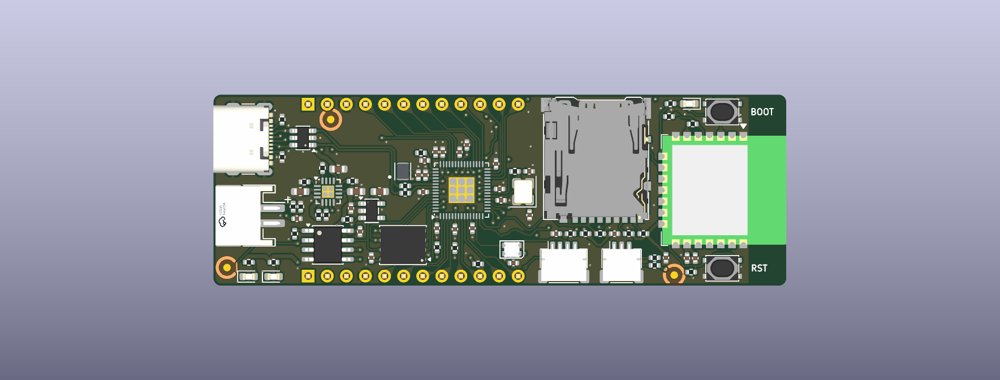
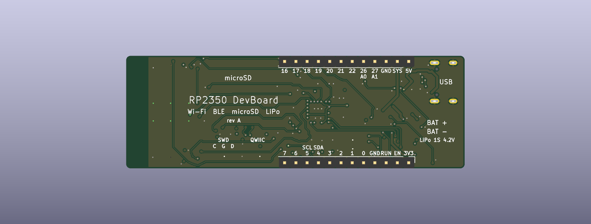
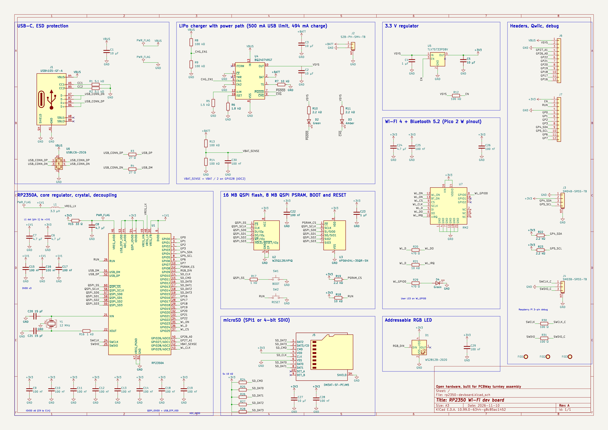

# RP2350 Wi-Fi dev board

A 76.2 × 25.4 mm, 4-layer RP2350A board laid out for PCBWay turnkey assembly. All assembled parts sit on the top side. The two 1×12 headers are fitted on the bottom, 22.86 mm (0.9 in) apart, so the board plugs into a breadboard with one free hole per side.

| Block | Part | Notes |
|---|---|---|
| MCU | RP2350A (SC1509-A4), QFN-60 | Order the A4 stepping. Core regulator copies Raspberry Pi's reference layout. |
| Flash | W25Q128JVPIQ, 16 MB, WSON-8 | QSPI CS0. IQ variant has QE fixed to 1. |
| PSRAM | APS6404L-3SQR-SN, 8 MB, SOP-8 | QSPI CS1 on GPIO8, 2.2 kΩ pull-up R19 |
| Crystal | ABM8-272-T3 12 MHz | 15 pF load caps, 1 kΩ series on XOUT, as on Pico 2 |
| USB | GCT USB4105-GF-A USB-C, USBLC6-2SC6 ESD, 27 Ω series | USB 2.0 full speed. 5.1 kΩ Rd on each CC pin. |
| Charger | BQ24074RGTR with power path | USB500 mode: 500 mA input limit, 494 mA charge (R6 1.8 kΩ), 10 kΩ TS resistor in place of a thermistor |
| 3.3 V | TLV75733PDBVR LDO, 1 A | Input is VSYS. EN is pulled up to VSYS and brought out to J7. |
| Battery | JST PH 2-pin (S2B-PH-SM4-TB) | Pin 1 is +, marked on silkscreen. VBAT/2 on GPIO28 (ADC2). |
| Radio | Raspberry Pi RM2 (CYW43439), Wi-Fi 4 + BLE 5.2 | Same GPIO23/24/25/29 wiring as Pico 2 W |
| microSD | Hirose DM3AT-SF-PEJM5 | GPIO10 to GPIO15, usable as SPI1 or 4-bit SDIO via PIO. 10 kΩ pull-ups, 10 µF local bulk. |
| Qwiic | JST SH 4-pin | I2C0 on GPIO4/GPIO5, 2.2 kΩ pull-ups |
| Debug | JST SH 3-pin | Raspberry Pi debug connector pinout, 100 Ω series |
| RGB LED | WS2812B-2020-V6 on GPIO9 | V6 is the variant rated for 3.3 V supply |
| LEDs | Green = power good, amber = charging, green = user LED on RM2 WL_GPIO0 | |
| Buttons | BOOT (QSPI_SS via 1 kΩ), RST (RUN) | |

## Pinout

Viewed from the top with the USB-C connector on the left, J6 is the top edge and J7 the bottom edge. Pin 1 of each header is next to the USB end. The same labels are printed on the bottom silkscreen.

| Pin | J6 (top edge) | J7 (bottom edge) |
|---|---|---|
| 1 | VBUS (5 V, straight from USB-C) | 3V3 |
| 2 | VSYS (charger output, 3.5 to 4.4 V) | EN (LDO enable, pull low to turn 3V3 off) |
| 3 | GND | RUN (low = reset) |
| 4 | GP27 / A1 | GND |
| 5 | GP26 / A0 | GP0 |
| 6 | GP22 | GP1 |
| 7 | GP21 | GP2 |
| 8 | GP20 | GP3 |
| 9 | GP19 | GP4 / SDA (shared with Qwiic) |
| 10 | GP18 | GP5 / SCL (shared with Qwiic) |
| 11 | GP17 | GP6 |
| 12 | GP16 | GP7 |

Internal GPIOs:

| GPIO | Use |
|---|---|
| 8 | PSRAM chip select (XIP_CS1n) |
| 9 | WS2812B data |
| 10 / 11 | microSD CLK / CMD |
| 12 to 15 | microSD DAT0 to DAT3 (DAT3 is CS in SPI mode) |
| 23 / 24 / 25 / 29 | RM2 WL_ON / data / CS / clock, as on Pico 2 W |
| 28 | Battery voltage / 2 (ADC2) |

## Firmware notes

- Start from pico-sdk's `pico2_w` board file and change `PICO_FLASH_SIZE_BYTES` to 16 MB. Remove its VSYS sense on GPIO29 and VBUS sense on WL_GPIO2. RM2 GPIO1 and GPIO2 are not connected here.
- Battery voltage is `2 × ADC2`. Call `adc_gpio_init(28)` so the digital input is off.
- Disable the GPIO8 pad pull-down before enabling XIP_CS1 for the PSRAM.
- The microSD card-detect switch is not connected. Firmware has to probe for a card.
- There is no GPIO for USB presence or charger status. The LEDs show PGOOD and CHG only.

## Layout decisions

- Stackup is PCBWay's standard 4-layer 1.6 mm with 1 oz copper on all layers: F.Cu signals with GND fill, In1 solid GND, In2 3V3 plane with a few signal tracks, B.Cu signals with GND fill. The stackup is written into the board file (7628 prepreg 0.1855 mm, core 1.03 mm, ENIG).
- Rules follow the strictest values in [`scratch/pcbway-notes.md`](scratch/pcbway-notes.md): 0.127 mm (5 mil) track and gap, 0.25 mm drill / 0.55 mm via, 0.15 mm annular ring, 0.5 mm hole to hole, 0.3 mm copper to edge. Two local exceptions are in `rp2350-devboard.kicad_dru`: 0.13 mm around VREG_LX, where the reference layout runs it between 0402 pads, and the USB4105's own peg-to-pad spacing.
- The core regulator (L1, C6, C7, C8) copies Raspberry Pi's reference layout, as the RP2350 datasheet requires. The QSPI bus, U1 fan-out and USB pair were routed by script and locked. An autorouter finished the rest.
- The USB pair is 0.22 mm / 0.15 mm gap over the In1 ground plane. It is not impedance controlled, which full speed USB does not need.
- Power tracks: VBUS and VSYS 0.5 mm, +BATT and 3V3 0.3 mm. 3V3 also uses the In2 plane.
- 40 GND return vias next to signal layer changes, 21 GND stitching vias, and teardrops on all pads and vias.
- The last 5 mm under the RM2 antenna is a keep-out with no copper on any layer. Keep metal away from that end in an enclosure.
- Three fiducials are on the top side. There are no mounting holes: the board is held by its headers.

## Caveats

These come from the design reviews in `scratch/review-*.md` and were accepted, not fixed:

- 3V3 back-feed: anything that powers J7.1 or the Qwiic 3V3 pin while the board is off drives the LDO output above its input. Do not feed 3V3 from outside.
- VBUS on J6.1 is tied straight to USB-C. 5 V fed there back-feeds a connected host. It is not 28 V tolerant, because U6 breaks down at 6 V.
- Battery drain: the 100 kΩ / 100 kΩ divider draws about 21 µA from the cell all the time. With 3V3 off it also feeds GPIO28 through 100 kΩ, which is current-limited and was judged safe.
- No battery protection on the board. Use a cell with its own protection circuit, 500 mAh or larger so 494 mA stays under 1C. Check polarity of third-party cells: many have red and black swapped.
- Without a battery the 500 mA USB limit covers RP2350, Wi-Fi transmit, SD writes and the RGB LED. Heavy peaks can brown out the 3V3 rail. A battery supplements the input.
- On battery, 3V3 drops out of regulation below about 3.5 V. Firmware should stop Wi-Fi and SD writes near 3.4 V.
- GP26 to GP29 are not 5 V tolerant. The other header GPIOs tolerate 5 V only while 3V3 is on.
- No ESD protection on Qwiic, debug or microSD lines.

### Not verified

- DM3AT card-detect pin numbering against the Hirose drawing. The pins are unused, so a mismatch only matters for a later revision.
- PTS810 pad pairing. The KiCad footprint assumes pads 1 and 2 are the switched pair.
- L1 orientation: the AOTA inductor is polarised, and the dot must go to pad 1 (+1V1). This was checked against the footprint, not a physical part.
- No board has been built or measured. All checks are ERC, DRC and datasheet reviews.

## Library notes

- `lib_footprint_mismatch` is set to ignore in the project. J5, J6, J7 and U7 differ from their library copies on purpose: their silkscreen was trimmed where it crossed the board edge.
- KiCad has no 3D models for J2 and D1. Their STEP files in `lib/3d/` came from LCSC through easyeda2kicad (C295747 and C965555, the same 2020 package as the V6 part). The J2 model offset of (1, -3, 0) mm was fitted by eye from renders. These models only affect the renders.
- RM2 symbol and footprint live in `lib/` and match Raspberry Pi's own KiCad footprint.

## Ordering from PCBWay

Upload `fab/rp2350-devboard-gerbers.zip`, `fab/bom-pcbway.csv` and `fab/centroid-top.csv`.

| Setting | Value |
|---|---|
| Layers | 4, order F.Cu / In1.Cu / In2.Cu / B.Cu |
| Thickness | 1.6 mm, standard stackup |
| Min track / spacing | 5/5 mil |
| Min hole | 0.25 mm |
| Copper | 1 oz outer, 1 oz inner |
| Solder mask / silkscreen | Green / white |
| Surface finish | ENIG |
| Panel | Panel by supplier with break-away rails on the long edges. The board is under 50 mm wide and USB-C is at the edge. |
| Assembly | Turnkey, top side only. J6 and J7 are through-hole on the bottom, see BOM notes. |
| Substitutes | No, except lines marked "Yes" in the BOM's substitutes column |
| X-ray | Ask for it on U1 (QFN-60) and U7 (RM2, LGA pads). The price is not in the instant quote. |

Text for the order notes field:

> Machine placement and reflow please, no hand soldering of U1. J1 shell legs are plated through-hole: pin-in-paste or hand solder. J6 and J7 are 1x12 headers fitted on the bottom side, pins pointing down, soldered from the top. L1 is polarised: dot to pad 1, marked on silkscreen. Please quote X-ray for U1 and U7.

Questions for the sales rep are listed at the end of `scratch/pcbway-notes.md`.

## Files

| Path | Content |
|---|---|
| `rp2350-devboard.kicad_pro` / `.kicad_sch` / `.kicad_pcb` | KiCad project |
| `lib/` | RM2 symbol and footprint, J2 and D1 STEP models |
| `docs/schematic.pdf`, `docs/rp2350-devboard.png` | Schematic exports |
| `fab/gerbers/` | 11 Gerber layers, PTH and NPTH drill files, drill maps, Gerber job file |
| `fab/rp2350-devboard-gerbers.zip` | The same files zipped for upload |
| `fab/bom-pcbway.csv` | PCBWay BOM with MPN, LCSC, Digi-Key and Mouser numbers, notes and substitutes |
| `fab/centroid-top.csv` | Pick and place, mm from the bottom-left corner (drill origin) |
| `fab/assembly-top.pdf`, `fab/assembly-bottom.pdf` | Assembly drawings |
| `fab/render-*.png` | 3D renders |
| `scratch/pcbway-notes.md` | PCBWay capabilities with sources, used to set the rules |
| `scratch/review-*.md`, `scratch/jst-polarity.md` | Design reviews |
| `scratch/sch/`, `scratch/pcb/`, `scratch/route/` | Scripts that generate the schematic, place, route and export the board |

### Regenerating

1. `bash scratch/sch/gen_real.sh` rebuilds the schematic, runs ERC and writes the netlist.
2. `scratch/pcb/02_place.py` places parts from `place.json`. `05_fanout.py` draws the hand-routed blocks and the U1 fan-out.
3. `IN2COST=6 bash scratch/route/full.sh g` routes the rest. Copy `g_best.kicad_pcb` to the root.
4. Run `06_unused_vias.py`, then the GND via pass: `route_planes.py rp2350-devboard.kicad_pcb --nets GND GND GND --plane-layers F.Cu In1.Cu B.Cu --skip-existing-zones --no-thermal-vias --stitch-vias --stitch-pitch 4 --add-gnd-vias --hole-to-hole-clearance 0.55`. Then `07_teardrops.py`, `08_silk.py`, and `09_fab.py`, which writes `fab/`.
5. `bash scratch/pcb/drc.sh` runs DRC with schematic parity.
