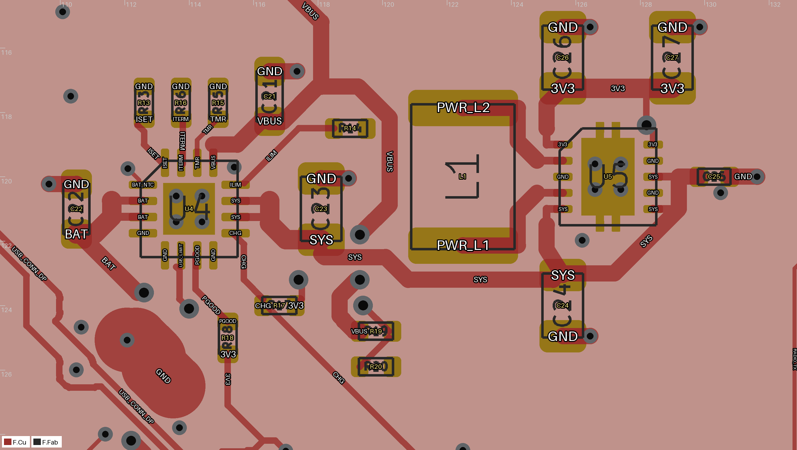
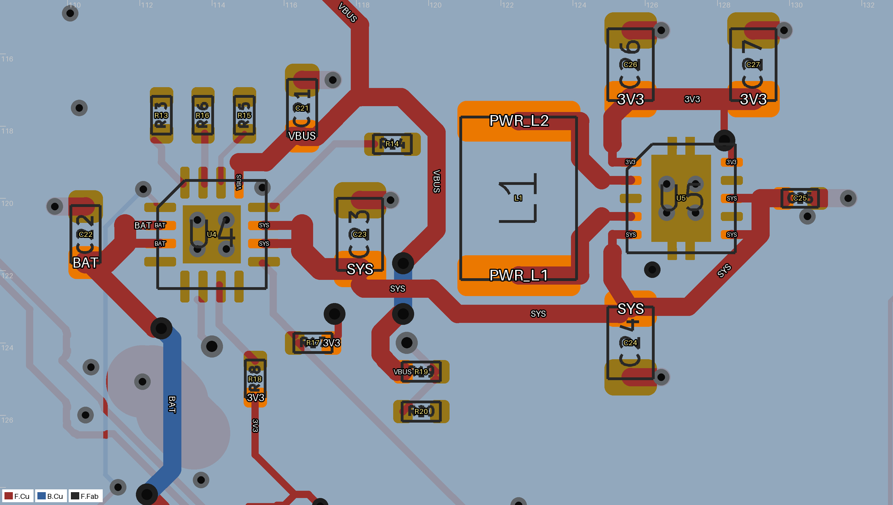

# Power layout handoff

Candidate: `power-revision.kicad_pcb`. Root board, schematic, and `tools/circuits.py` were not edited. No silkscreen or library-mismatch workaround was added.

## Reproduce

```bash
kicad-python "$SPROCKET_KICAD_ROUTING_TOOLS/py_router/copy_board.py" sprocket2350.kicad_pcb scratch/power-revision.kicad_pcb
kicad-python tools/power_layout.py scratch/power-revision.kicad_pcb
KICAD_RIP_PREEXISTING=0 KICAD_FINALIZE_RIP=0 kicad-route \
  scratch/power-revision.kicad_pcb scratch/power-routed.kicad_pcb \
  --nets /VBUS /SYS /BAT /ISET /ILIM /TMR /ITERM /USB_LIMIT /CHG /PGOOD /3V3 \
  --layers F.Cu In1.Cu In2.Cu B.Cu --layer-costs 1 -1 3 3 \
  --keep-input-copper --escalation off --strict-sizes --no-fix-drc-settings \
  --track-width 0.2 --power-nets /VBUS /SYS /BAT \
  --power-nets-widths 0.5 0.5 0.5 --no-power-tap-neckdown --neckdown-length 0.8
```

The full route's improvement gate accepted: 27 disconnected pads before, zero after; no lost or worsened nets. Strict sizes returned 3 because it counts explicit pad necks and preserved USB VBUS copper. This is not a strict-size pass. Inspect `power-route-full.log`.

## Placement

Coordinates are absolute mm. Rotation is KiCad degrees.

| Reference | X | Y | Rotation |
|---|---:|---:|---:|
| U4 | 114 | 121 | 0 |
| U5 | 127 | 120 | 0 |
| L1 | 122.5 | 120 | 90 |
| C21 | 116.5 | 117.5 | 90 |
| C22 | 110.5 | 121 | 90 |
| C23 | 118.1 | 121 | 90 |
| C24 | 125.6 | 124 | 270 |
| C25 | 130.3 | 120 | 0 |
| C26 | 125.6 | 116.3 | 90 |
| C27 | 129 | 116.3 | 90 |
| R13 | 112.6 | 117.7 | 90 |
| R14 | 119 | 118.5 | 0 |
| R15 | 114.9 | 117.7 | 90 |
| R16 | 113.75 | 117.7 | 90 |
| R17 | 116.8 | 124 | 180 |
| R18 | 115.2 | 125 | 90 |
| R19 | 119.8 | 124.8 | 0 |
| R20 | 119.8 | 125.9 | 0 |

## Copper and current paths

Rebuilt nets: VBUS outside the preserved USB region, SYS, BAT, PWR_L1, PWR_L2, ISET, ILIM, TMR, ITERM, USB_LIMIT, CHG, PGOOD. Reconnected relocated 3V3/GND pads. Unrelated tracks/vias match root after excluding the document-parent UUID. In1 has zero tracks.

| Net | Total track length, mm | Main widths, mm | Narrow sections |
|---|---:|---|---|
| PWR_L1 | 4.386 | 0.5 | 0.24 × 0.8 mm at U5 |
| PWR_L2 | 4.386 | 0.5 | 0.24 × 0.8 mm at U5 |
| SYS | 22.505 | 0.5–0.6 | 0.24 × 2.6 mm total, 0.25 × 2.125 mm total |
| BAT | 34.186 | 0.5–0.6 | Two 0.25 × 0.9625 mm U4 pad escapes |
| VBUS | 40.109 | 0.5 | U4 0.25 × 0.5625 mm; preserved USB 0.12 × 0.707 mm and 0.2 × 1.11 mm |

U5 switch-node lengths fell from approximately 9.67/7.75 mm to 4.386/4.386 mm. No switch-node vias remain. The 0.24/0.25 mm necks fit the 0.5 mm-pitch pads and widen after leaving adjacent pad copper. SYS includes low-current EN/VINA branches. BAT is sized for discharge, not only 303 mA charging. The preserved USB VBUS narrow copper needs the USB owner's current-path review. Main 0.5 mm paths still need thermal qualification for roughly 1.2 A battery/SYS operation; this is not an ampacity sign-off.

Each power capacitor has its own nearby GND via. Each IC exposed pad has four 0.45 mm copper / 0.20 mm drill through-vias at center ±0.4 mm. Saved drill attributes are filled and capped. Specify IPC-4761 type VII nonconductive resin fill, planarization, and copper cap to the fabricator. Fabricator acceptance and assembly paste qualification remain required.

## Checks

- Final DRC: zero errors, zero unconnected. 106 warnings: 93 footprint-library mismatches, 11 unrelated dangling vias, two unrelated dangling tracks. No severities changed.
- Assembly audit: zero blockers, zero courtyard overlap, zero pad/hole conflicts.
- Root PCB and schematic hashes remained unchanged.
- Cleanup, syntax, and Ruff checks passed.
- Repeated script invocation completed successfully. The script resets owned routing, so rerun the router afterward.

## Datasheet and electrical review

Exact TI URLs fetched during this work:

- BQ24074: https://www.ti.com/lit/ds/symlink/bq24074.pdf, SLUS810N, October 2021, §12.
- TPS63001: https://www.ti.com/lit/ds/symlink/tps63001.pdf, SLVS520C, October 2015, §10.

No pin mapping or electrical connectivity was changed. Fixed-output U5 FB tied to 3V3 is correct. R14 does not set the active input limit: EN2 low/EN1 high selects USB500, 450–500 mA. R13 sets approximately 303 mA nominal charging. The USB budget includes system and charging current. Battery supplementation is needed for larger loads.

Unresolved: LQH44PN2R2MP0L is discontinued and its 4 × 4 mm body/terminal pattern needs comparison with the generic 1812 footprint. VINA lacks the reference circuit's 100 Ω filter. Effective MLCC capacitance under bias, thermal performance, EMI, and pack protection require qualification. The same-net GND plane is preserved; no separate quiet-ground island was introduced without a schematic net tie.



