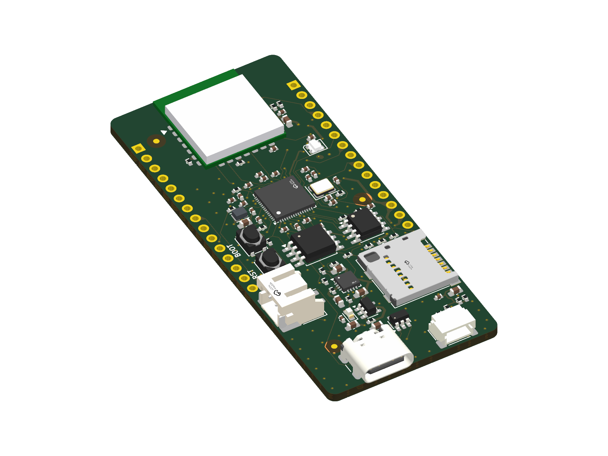
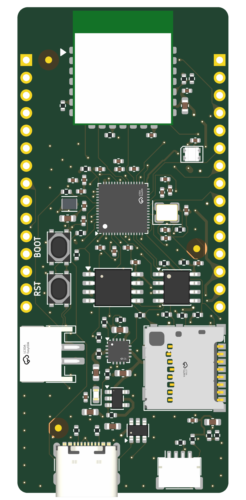
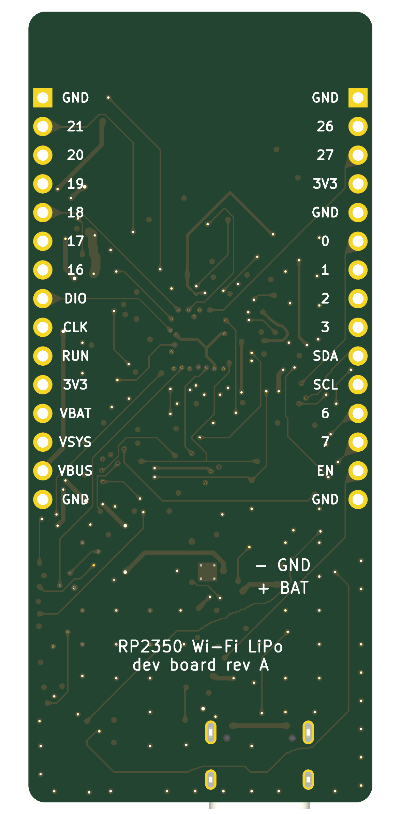
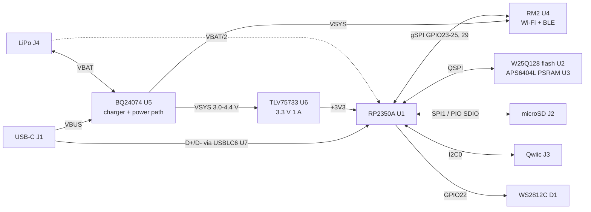
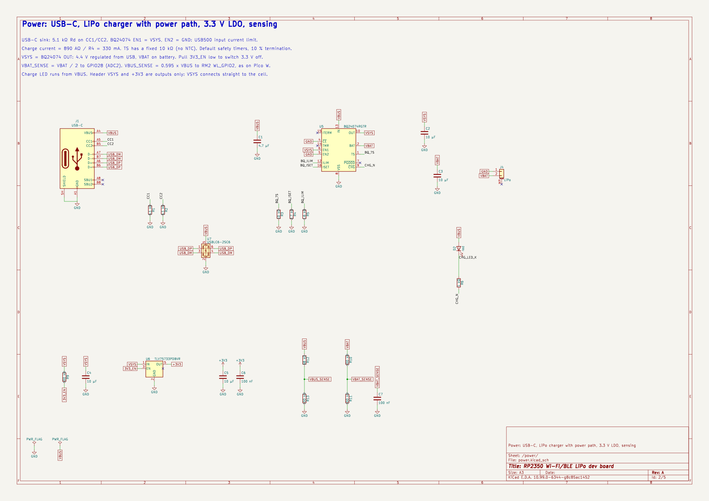
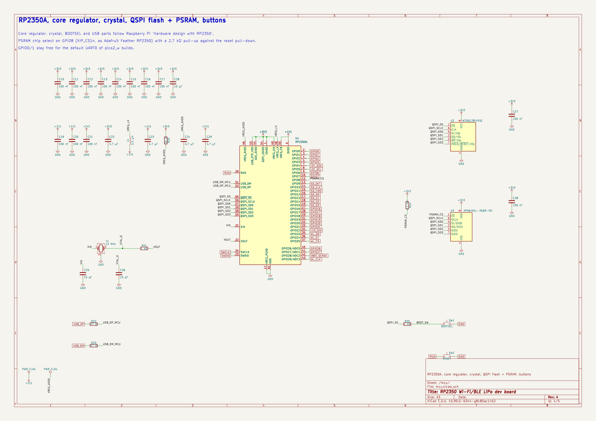
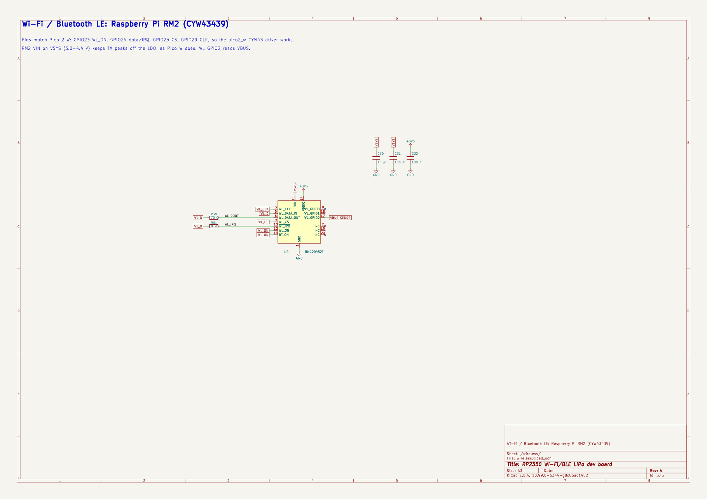
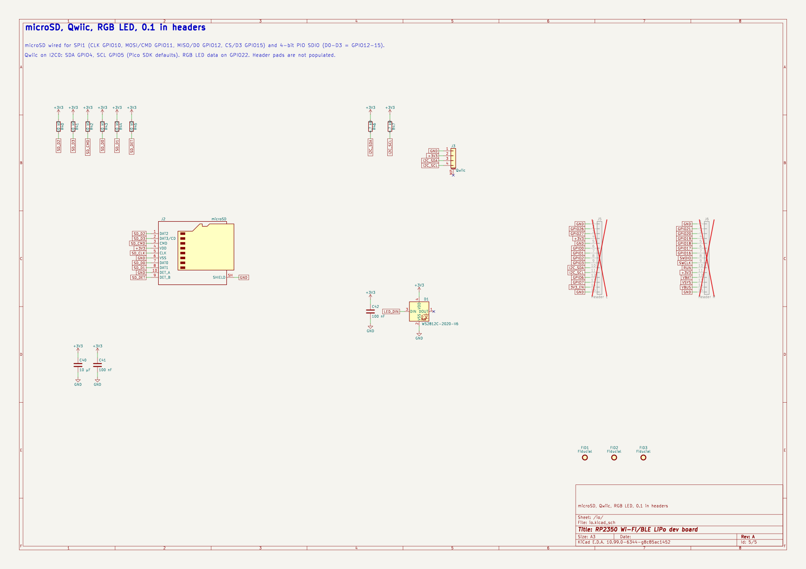

# RP2350 Wi-Fi/BLE LiPo dev board, Rev A

A 30.48 × 70 mm, 4-layer RP2350 board for PCBWay turnkey fabrication and assembly. All 77 parts sit on the top side. It has:

- RP2350A (A4 stepping) with 16 MB QSPI flash and 8 MB QSPI PSRAM
- USB-C for power and USB 1.1 full-speed data
- BQ24074 LiPo charger with power path, plus battery and VBUS voltage sensing
- Raspberry Pi RM2 module (CYW43439) for Wi-Fi 4 and Bluetooth 5.2, wired like the Pico 2 W
- microSD socket with card detect, Qwiic/STEMMA QT connector and a WS2812C-2020 RGB LED
- BOOTSEL and RESET buttons and two 15-pin 0.1 in header rows (pads only)



| Top | Bottom |
| --- | --- |
|  |  |

## Files

| Path | Content |
| --- | --- |
| `rp2350_dev.kicad_pro`, `*.kicad_sch`, `rp2350_dev.kicad_pcb` | KiCad project: root sheet plus power, mcu, wireless and io sheets |
| `lib/` | RM2 symbol and 3D models from LCSC (easyeda2kicad) |
| `fab/` | Everything PCBWay needs. [`fab/README_fab.txt`](fab/README_fab.txt) holds the order notes |
| `scripts/` | Generators: `design.py` is the circuit source of truth |
| `docs/` | Schematic and 3D renders used here |

## Block diagram



## Power behaviour

| Source present | VSYS | Battery |
| --- | --- | --- |
| USB only | 4.4 V from USB, input limit USB500 (about 450 mA min) | none |
| USB + LiPo | 4.4 V from USB. The cell supplements it when the load exceeds the input limit | charges at 330 mA (R4 = 2.7 kΩ), red LED D2 on while charging |
| LiPo only | follows VBAT (3.0-4.2 V) | discharges |

- The 3.3 V LDO and the RM2 VIN both run from VSYS, as on the Pico W. Wi-Fi TX peaks don't load the LDO.
- `3V3_EN` (J5 pin 14) has a 100 kΩ pull-up to VSYS. Pull it low to turn 3.3 V off. It sits at VSYS level, up to 4.4 V, so drive it open-drain.
- Battery voltage reads on GPIO28 (ADC2) as VBAT / 2. VBUS reads on RM2 WL_GPIO2 as 0.595 × VBUS, the same as the Pico 2 W.
- The TS pin has a fixed 10 kΩ, so the board has no cell temperature sensing. Use cells with their own protection PCB.

## Pinout

GPIO map (design.py `GPIO`):

| GPIO | Function | GPIO | Function |
| --- | --- | --- | --- |
| 0-3 | header (UART0 on 0/1) | 16-21 | header |
| 4 / 5 | I2C0 SDA / SCL: Qwiic, 4.7 kΩ pull-ups | 22 | WS2812C data |
| 6, 7 | header | 23 | RM2 WL_ON |
| 8 | PSRAM CS (XIP_CS1n) | 24 | RM2 data / IRQ |
| 9 | SD card detect, low = card present | 25 | RM2 CS |
| 10 | SD CLK | 26, 27 | header (ADC0, ADC1) |
| 11 | SD CMD / SPI1 MOSI | 28 | VBAT / 2 (ADC2) |
| 12-15 | SD D0-D3 (D0 = MISO, D3 = CS) | 29 | RM2 CLK |

Headers, top view, pin 1 (square pad) at the RM2 end:

| Pin | J5 left | J6 right |
| --- | --- | --- |
| 1 | GND | GND |
| 2 | GPIO26 | GPIO21 |
| 3 | GPIO27 | GPIO20 |
| 4 | +3V3 (out) | GPIO19 |
| 5 | GND | GPIO18 |
| 6 | GPIO0 | GPIO17 |
| 7 | GPIO1 | GPIO16 |
| 8 | GPIO2 | SWDIO |
| 9 | GPIO3 | SWCLK |
| 10 | SDA (GPIO4) | RUN |
| 11 | SCL (GPIO5) | +3V3 (out) |
| 12 | GPIO6 | VBAT |
| 13 | GPIO7 | VSYS (out) |
| 14 | 3V3_EN | VBUS |
| 15 | GND | GND |

## Firmware

Build with `PICO_BOARD=pico2_w` plus a board header that sets:

- PSRAM: CS on GPIO8 and 8 MB.
- Flash: 16 MB.

Keep the PSRAM clock at 84 MHz or below. The APS6404L limits linear bursts across page boundaries above that. The Wi-Fi pins already match `pico2_w`, so the CYW43 driver works unchanged. The only user LED is the WS2812 on GPIO22, so `PICO_DEFAULT_LED_PIN` doesn't apply.

## Key design decisions

| Decision | Reason |
| --- | --- |
| RP2350A (QFN-60) with external flash | 30 GPIO is enough, and external flash lets the size be chosen (16 MB here) |
| RM2 module, not a bare CYW43439 | Pre-certified with an on-module antenna, uses the Pico 2 W driver, and needs no RF layout. No copper on any layer within 5.5 mm of the top edge, under the antenna |
| BQ24074 | Power path, USB500 input limit set by its EN pins, 1.5 A capable charger in QFN-16 |
| Charge current 330 mA | Safe for cells of 330 mAh and larger at 1C, and fits under the 450 mA USB500 limit with the board running |
| TLV75733 LDO from VSYS | 1 A, low dropout at the 3.0 V end of a LiPo, active discharge |
| PSRAM CS on GPIO8 with 2.7 kΩ pull-up | Same pin as the Adafruit Feather RP2350. The pull-up overrides the reset pull-down so the PSRAM stays deselected |
| microSD on GPIO10-15 | Works with SPI1 and with 4-bit PIO SDIO |
| Power enters only through VBUS | All input current passes the charger's USB500 limit. VBUS on J6 is an input up to 5.5 V, because 0.595 × 5.5 V = 3.27 V on the RM2 sense pin. On USB it is an output |
| No ESD parts on CC or Qwiic | Accepted risk to save space. USBLC6 covers D+/D- and VBUS. The CC lines only see 5.1 kΩ Rd |
| Headers not populated | Keeps assembly SMT-only and lets the user choose pins, sockets or direct wires |
| Board 30.48 × 70 mm | Header rows 27.94 mm (1.1 in) apart on the 0.1 in grid, so perfboard fits |

Accepted trade-offs:

- The VBAT divider (2 × 100 kΩ) draws 21 µA from the cell at all times.
- Header VSYS and +3V3 are outputs only. VSYS connects straight to the cell, so back-feeding it bypasses the charger.

## Reviewer notes

- Via-in-pad: about 75 vias sit in SMD pads (U1 QFN-60, U5 thermal pad, several 0402s). The board needs filled and capped vias (IPC-4761 Type VII). This is in the fab notes and adds cost at PCBWay. Rerouting without it isn't practical at this density.
- Layer use: In1 is a solid GND plane under the whole board, and F.Cu signals reference it. In2 is the +3V3 plane, but it also carries signal tracks, so it has voids near U1. DRC confirms the plane stays connected.
- Signal return paths: QSPI runs mostly on B.Cu (about 80 mm) and In2 (about 40 mm), where the nearest reference is the voided +3V3 plane or the B.Cu GND pour. Each net is 20-45 mm long, which is fine for flash at the default clock. Check this before running flash or PSRAM above 100 MHz. USB D+/D- runs mostly on F.Cu over In1. D- has about 8 mm each on In2 and B.Cu, which is fine at 12 Mbit/s full speed.
- DRC: 0 errors, 0 unconnected, 0 schematic parity issues. Two `lib_footprint_mismatch` warnings on J5/J6 are intentional. Their front silk outline ran off the board edge and was removed.
- Hand edits after autorouting: an I2C_SCL via at (115.43, 81.45) and a GPIO6 via at (115.64, 83.08) in board coordinates, plus reroutes of QSPI_SCLK, GPIO7 and a +3V3 link to the In2 plane.
- The battery polarity follows Adafruit/SparkFun JST PH cells (pin 1 = GND). The silk on the back marks "- GND" and "+ BAT". Check any cell before plugging it in.
- Centroid rotations use the KiCad convention. Ask PCBWay to confirm polarity of U1-U7, D1, D2, L1 and Y1 against the assembly drawing.
- Most custom 3D models came from LCSC. The RM2 model is a hand-made box. Placement was checked in the renders, but not against mechanical drawings.

## Sourcing

Every BOM line has a manufacturer MPN and an LCSC number. The RP2350A (SC1509-A4) is LCSC C42411118, and the RM2 is C49451547. PCBWay sources parts itself, so the LCSC numbers are references. The distributor numbers were checked on each distributor's own page in July 2026. Recheck stock when ordering. The BOM's Alternate column lists approved substitutes, for example APS6404L-3SQN-SN for the PSRAM.

## Schematic






## Regenerating

Run each kipy step with a fresh `kicad-cli api-server`. Run `finish_files.py` with the server stopped, because it edits the board file directly.

```bash
kicad-python scripts/gen_schematic.py          # schematic from design.py
kicad-python scripts/gen_board.py create        # board, outline, placement, zones, drill origin
kicad-python scripts/gen_board.py rules
# routing: kicad-route, then route_planes.py GND stitching (see git history)
kicad-python scripts/gen_board.py teardrops
kicad-python scripts/gen_board.py silk
python3 scripts/finish_files.py                 # 3D models, stackup, title block, text angles
python3 scripts/gen_fab.py                      # fab/: Gerbers, drill, BOM, centroid, assembly PDF
kicad-cli pcb drc --refill-zones --schematic-parity --severity-all rp2350_dev.kicad_pcb
```
